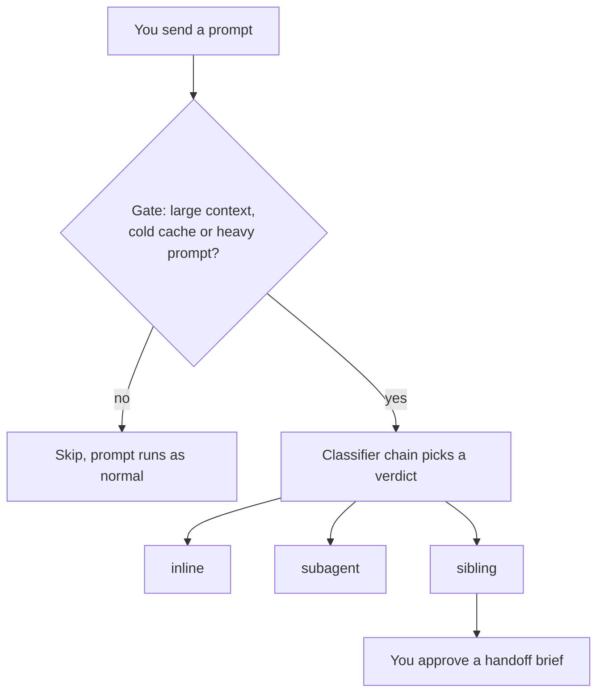

# jev-relayer

**Send each task to the right place and the right model.**

jev-relayer watches your prompts in Claude Code and Codex. For each one it decides whether the work
should run in your current session, in a subagent, or in a separate background session. It also
picks the model, and the reasoning effort, for that turn. A small, cheap classifier makes the call
before the expensive model starts work.

Started from [psadventure/jev-model-router](https://github.com/psadventure/jev-model-router)
(MIT). See [THIRD_PARTY_NOTICES.md](THIRD_PARTY_NOTICES.md).

## Why use it

- **Spend less on easy work.** A rename or a quick question goes to `haiku`. A hard refactor keeps `opus`.
- **Keep your main session clean.** Fan-out work such as "audit the whole repo" moves to a subagent
  or a background session, so it stops filling your context window.
- **Stay in control.** It never blocks a prompt. A background session starts only after you approve
  a handoff brief.

## What you see

Each time jev-relayer acts, it prints one line:

```
↪ jev-relayer: subagent · sonnet · 0.90
↪ jev-relayer: sibling session · sonnet · 0.85
↪ jev-relayer: subagent model → haiku
⚠ jev-relayer: no classifier answered, using heuristics
```

The last number is the classifier's confidence.

## The three verdicts

| Verdict | Meaning | What happens |
| --- | --- | --- |
| `inline` | Do the work here | The turn runs in your session, on the picked model and effort when you use the mod. |
| `subagent` | Delegate it | The model gets an instruction to hand the work to a subagent, on the picked model. |
| `sibling` | Run it in the background | The model writes a handoff brief and shows it to you. After you approve, it runs `claude --bg` or `codex exec`. |



## Quick start

1. Load this directory as a Claude Code plugin:

   ```bash
   CLAUDE_CODE_PLUGIN_DIRS=/path/to/jev-relayer claude
   ```

   The plugin registers the `Agent` model hook and the mod, which classifies every turn.
2. For the hook route, register the prompt hook for both agents through tackroom (`hooks:` in
   `tackroom.yaml`). It runs `node hooks/prompt-submit.mjs claude` or `... codex`.
3. Check that it is on:

   ```bash
   jev-relayer status
   ```

Turn it off for one agent with `jev-relayer off codex`, for everything with `jev-relayer off all`, and
back on with `jev-relayer on all`. `JEV_RELAYER=off` disables it for one process. The old `JEV_RELAY=off` still works. The first run moves `~/.config/jev-relay` and `~/.local/state/jev-relay` to the `jev-relayer` names without overwriting newer files.

## How it works

Three pieces share one classifier.

- **Hook** (`hooks/prompt-submit.mjs`, on `UserPromptSubmit`). It reads the transcript for context
  size and cache age, and stays silent unless the gate opens. When it opens, it asks a classifier
  and injects one line of advice. It never blocks a prompt.
- **Subagent hook** (`hooks/agent-model.mjs`, on `PreToolUse` for `Agent`, Claude only). It sets the
  subagent model unless one was given.
- **Mod** (`hooks/register.tsx`). A Claude Code mod that works wherever Claude Code loads mods
  (terminal, Desktop, VS Code), with no proxy and no `ANTHROPIC_BASE_URL`. Remote Control keeps
  working.

The mod differs from the hook in these ways:

- It classifies every turn, with no context-size gate.
- It runs the turn on the model the classifier picks when the verdict is inline. `/model` stops it
  for that session.
- A subagent verdict adds an instruction to delegate, and the picked model applies to the subagent.
- Switching to a stronger model always happens. Switching to a cheaper one happens inline only when
  the context is under `gate.coldMinTokens` or the cache has been idle for `gate.cacheTtlMs`.
  Otherwise the session stays on its model, because a switch re-reads the whole context at full
  price. Delegating to a subagent or sibling avoids that cost.
- A sibling verdict asks you to approve. Approving runs `claude --bg` (or a background subagent
  where the CLI is unavailable) with your prompt as the brief.

### When the hook classifies

The hook skips a prompt unless one of these holds:

- The session is young: fewer than `gate.earlyPrompts` (3) earlier prompts, whatever the context size. A fresh session already carries tens of thousands of tokens of system prompt and tools, so a size floor cannot catch it.
- The conversation is large (`gate.contextTokens`, 100k).
- The cache is cold on a context of at least `gate.coldMinTokens` (20k).
- The prompt looks heavy and the context is at least `gate.heavyFloorTokens` (40k).

A heavy prompt matches a regex in `gate.heavyPatterns`: by default fan-out slash commands such as
`/peer-review-pr` and `/deep-plan`, and phrases such as "audit the whole repo". A list you write
replaces the default list.

### Classifier chains

A chain lists providers in order, and the first that answers wins. `chain` sets the default,
`["jev", "heuristics"]`. A profile gives matching repositories their own chain:

```json
{
  "profiles": [
    { "name": "personal", "match": ["your-github-name"], "chain": ["jev", "heuristics"] },
    { "name": "client", "match": ["acme-corp"], "chain": ["heuristics"] }
  ]
}
```

- `match` holds strings tested against the repo's `origin` URL. The first profile with a hit wins.
- A repo that matches no profile, or has no remote, uses `chain` and reports as `default` in stats.
- `profiles` is empty by default.

Providers: `jev` (OpenRouter or TypeSafe), `ollama`, `openai-compat`, `apple`, `heuristics`. `ollama`,
`openai-compat` and `apple` need a `providers` entry of your own before a chain can name them.

If every classifier fails, the hook says so once per session and falls back to heuristics.

### Add a local model to the chain

Define the model under `providers`, then name it in a chain. Any URL works: `localhost`, a LAN
address or a Tailscale IP.

```json
{
  "chain": ["jev", "local", "heuristics"],
  "providers": {
    "local": { "type": "ollama", "baseUrl": "http://localhost:11434", "model": "qwen3:8b", "timeoutMs": 8000 }
  }
}
```

- `ollama` and `openai-compat` count as local, so a redaction hit keeps them in the chain. Set
  `"remote": true` on one that sends prompts off your network.
- Put the local provider first to keep prompts on your machines whenever it is up.
- The first call after the model idles loads it, which can exceed `timeoutMs`. That call falls
  through to the next provider.
- A provider that keeps failing is skipped by the circuit breaker, so a powered-off host costs
  one timeout, not one per prompt.

### Use Apple Intelligence

The `apple` provider runs Apple's on-device model through a small Swift helper. It needs macOS 26
or later with Apple Intelligence turned on.

1. Build the helper:

   ```bash
   bun run build:apple
   ```

2. Name it in a chain:

   ```json
   {
     "chain": ["apple", "jev", "heuristics"],
     "providers": { "apple": { "type": "apple", "timeoutMs": 8000 } }
   }
   ```

- Guided generation limits each answer to the offered choices, so the reply always parses.
- The model's context window is about 4k tokens. The 6000-character excerpt every provider gets fits in it.
- It counts as local. Prompts never leave the Mac.
- If Apple Intelligence is off, the helper is missing or the model refuses, the chain moves on.
- `binary` overrides the helper path.

### Privacy

- Prompts are redacted before they leave the machine, in personal and work repos alike.
- A redaction hit drops the remote provider for that prompt, so heuristics answer instead.
- To keep a repo class off remote providers, set its chain to local providers and `heuristics`.
- Tool results are never sent. Only prompts and assistant prose are.
- The classifier sees your prompt and up to `excerptTurns` (10) earlier messages, newest first, until
  the excerpt reaches 6000 characters. Each message is cut to 1500 characters.

## Configure

Defaults live in `src/defaults.mjs`. Override any of them in `~/.config/jev-relayer/config.json`:

```json
{ "chain": ["heuristics"], "redact": { "names": ["Acme"] } }
```

Keys come from the environment or `~/.config/jev-opus/.env`: `OPENROUTER_API_KEY`,
`TYPESAFE_API_KEY` or `JEV_API_KEY`.

### Models

`models` lists the models the classifier may pick, with a separate list for each agent. Write a
list of names, from weakest to strongest. Known models borrow their built-in description, which the
classifier reads to choose. Delete a name to disallow it. A list you write replaces that agent's
default list, so name every model you want to keep.

```json
{ "models": { "claude": ["haiku", "sonnet"], "codex": ["gpt-6-luna"] } }
```

A model the built-ins don't know needs a description, so write that agent's list as an object:
`{ "gpt-x": "what it is good for" }`.

Defaults: Claude allows `haiku`, `sonnet` and `opus`. Codex allows `gpt-6-luna`, `gpt-6.1-terra` and
`gpt-6.1-sol`. If the classifier answers with a model that is not on the list, that provider's answer
is rejected and the next provider in the chain runs. An agent with an empty list gets no model
question. The sibling nudge carries the chosen model: `claude --bg --model <name>` or
`codex exec -m <name>`.

### Effort

The same classifier call picks a reasoning effort for each turn, next to the model. Effort routing
keeps a cheap model from over-thinking and a strong model from under-thinking.

| Level | Classifier picks it for |
| --- | --- |
| `low` | Mechanical, lookup or clearly specified work. The default |
| `medium` | Coding or review that weighs options or traces behavior across files |
| `high` | Hard debugging, design and multi-step reasoning |
| `xhigh` | The hardest work, where extra reasoning pays off |

Where it applies:

- **Mod, inline verdicts only.** The mod sets the effort on the turn, together with the model, when
  the session model takes an effort. The effort applies even when a model switch is blocked by the
  cache rules, so a session can stay on `opus` and still drop to `low`.
- **Not applied** to subagent or sibling verdicts, to the hooks, to Codex, or to heuristic verdicts,
  which carry no effort. Verdicts under `minConfidence` are treated as inline with no pick.
- **Manual override wins.** After you run `/model`, routing stops for that session, effort included.

The verdict line shows the result, for example `jev → haiku · low · 0.90`. `jev-relayer stats` counts
verdicts by effort, and each `applied` event records the effort asked for and the effort set.

`efforts` holds the levels and their descriptions. Write your own to replace the default, for
example to retire `xhigh`:

```json
{ "efforts": { "low": "Quick, specified work", "medium": "Anything that needs thought", "high": "Hard problems" } }
```

Set `"efforts": {}` to stop asking. Keys must be `low`, `medium`, `high` or `xhigh`; the mod ignores
any other level.

### Confidence thresholds

- A remote verdict with confidence below `minConfidence` (default `0.6`) is treated as inline: no
  nudge and no model pick. Heuristic verdicts are not affected. A value outside 0–1 falls back to
  the default.
- A sibling verdict needs at least `siblingMinConfidence` (default `0.85`), or it is treated as
  inline. The first prompt of a session never gets a sibling verdict.

### Feedback

Each nudge and each subagent model pick prints one line to you through the hook's `systemMessage`
field. The model sees the full advice, and you see the line.

The hook prints a line when it nudges, never for an inline verdict, because the hook cannot change
the model. Set `"report": "every-turn"` to also see a line for skipped prompts:

```
· jev-relayer: skipped · 30k tokens, cache warm
· jev-relayer: skipped · cooling down (1/3)
```

The mod applies the pick, so it reports the final verdict. It writes one dim line to the transcript
after the turn's model is settled. The line is not sent to the model:

```
jev → haiku · low · 0.90
jev: staying on opus · haiku skipped, 152k context is cached · low · 0.98
jev: sonnet · low
```

Set `"macNotifications": true` to also get a native macOS notification whenever jev-relayer acts or
the decision changes. It is off by default.

### Toolsets

A toolset limits the tools a sibling session starts with, so it loads fewer tool schemas and MCP
server instructions. In a test with `claude -p` on haiku, `--strict-mcp-config` plus
`--tools Read,Grep,Glob,Bash` cut the starting input from 37.5k to 16.2k tokens.

Define toolsets in `~/.config/jev-relayer/config.json`. See `config.example.json`.

```json
"toolsets": {
  "lean": { "description": "Read-only search and summaries.", "claude": { "tools": ["Read", "Grep", "Glob", "Bash"] } },
  "work": { "description": "Needs Linear or Harvest.", "claude": { "mcpConfig": "~/.config/jev-relayer/mcp-work.json", "tools": ["Read", "Bash", "Edit"] } }
}
```

The classifier reads each `description` and picks one. For a Claude sibling, jev-relayer adds
`--strict-mcp-config`, `--mcp-config <file>` when `mcpConfig` is set, and `--tools <list>`. With no
`toolsets` key, nothing changes. Toolsets apply to Claude siblings only. Subagents are not covered yet.

### Band and verdict line

The band above the prompt shows the latest verdict, for example `jev: inline · haiku · 0.83`, with a
Switch button when the pick differs from the session model. It is off by default:

```bash
jev-relayer band on
jev-relayer band off
```

The mod also writes its verdict line to the transcript when it picks a model or effort. Turn that
off with `"statusNotice": false`. The status line's model slot still shows the routed model.

## Metrics

Both paths write JSONL events with no prompt text, only lengths. The hooks append to
`~/.local/state/jev-relayer/relay.log`. The mod writes one file per session under
`~/.local/state/jev-relayer/mod/`.

| Event | Source | Records |
| --- | --- | --- |
| `prompt` / `decision` | hook / mod | provider, verdict, raw verdict behind a low-confidence override, latency, failures with timings, redaction hits, whether it nudged |
| `skip` | hook | gate or cooldown reason, context size |
| `agent` / `spawn-model` | hook / mod | subagent model pick and its source (`classifier`, `cached`, `explicit`) |
| `applied` | mod | model and effort applied, the model that served the turn, whether it matches the pick, token usage |
| `action` | mod | subagent spawned, sibling accepted, declined or failed |
| `regret` | mod | the prompt after a downgraded turn read as a correction or retry |
| `manual` | mod | you changed the model yourself, which stops routing for the session |
| `deadline-miss` | mod | the classifier answered too late to affect the turn |

```bash
jev-relayer stats              # everything
jev-relayer stats --days 7     # last week
jev-relayer stats --json       # machine-readable
```

Read the report as a checklist:

- **Heuristic fallback and failures**: a high rate means a classifier is down or too slow.
- **Latency p95 and deadline misses**: verdicts that arrive late never apply.
- **Confidence buckets and low-confidence rate**: too many verdicts under `minConfidence` means the
  threshold or the classifier needs work. Each low-confidence log entry carries the first 200
  characters of the prompt, with `redact.names` applied, so you can read what the classifier
  struggled with.
- **Manual overrides and sibling acceptance**: you rejecting the router is the clearest wrong signal.
- **Served ≠ picked**: the router asked for one model and another answered.
- **Estimated cost**: the mod prices each turn's token usage by the model that served it and compares
  it with the same tokens on the session model. Prices per million tokens are in `pricing` and
  are estimates. Turns logged before this feature have no cache-write count and are left out.
- **Effort mix**: a router that answers `high` for most turns is not saving anything. Tighten the
  descriptions in `efforts`.
- **Downgrades, blocked and regret**: a downgrade is a switch to a cheaper tier. Regret is the share
  of downgrades whose next prompt starts like a correction ("no", "try again", "still failing").
  If regret climbs, loosen the model descriptions in `models`.
- **Gate skip rate**: how often the gate hides turns the router could have helped.

## Develop

```bash
npm test             # modules and hooks, on Node
npm run test:mod     # the mod (hooks/register.tsx) against a fake engine, needs Bun
npm run typecheck    # tsc over the mod and the .mjs modules it imports
```
